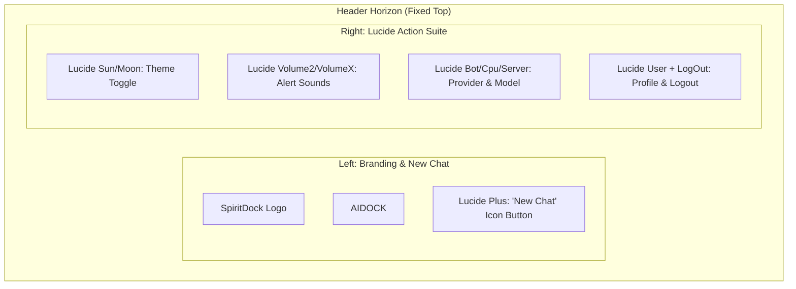
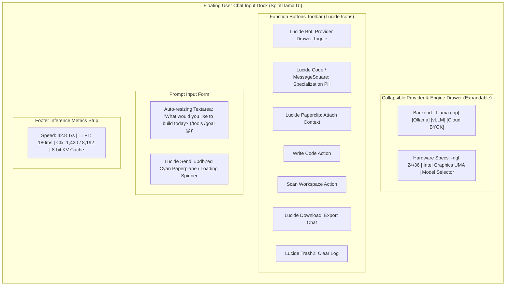

# AIDock UI Frontend — Corrections & Refactoring Plan

This document outlines the detailed architectural, visual, and implementation corrections for the AIDock UI frontend based on visual inspection of `http://localhost:3000/`, matching the SpiritLlama / SpiritBird design language and user specifications.

Icon Library Standard: All interface controls use `lucide-react`, matching the SpiritLlama UI standard (`C:\AppDev\My_Linkdin\projects\iarxii\OllamaOpt\ui`). No emojis are used in the interface or system specifications.

---

## 1. Header Corrections

### 1.a Neural Lines p5 Animation (Strand Tapering & Anti-Clipping)

#### Current Implementation Analysis
- In [App.tsx](file:///c:/AppDev/My_Linkdin/projects/iarxii/AI_Dock/client/src/App.tsx#L148-L173), the header canvas (`<canvas ref={p5CanvasRef}>`) is anchored at `top-0 right-0 w-[540px] h-full`.
- The animation draws 5 sinusoidal strands (`numLines = 5`).
- **Defects identified:**
  1. **Horizontal Boundary Clipping:** Every strand iterates from `x = 0` to `x = width`. All 5 strands terminate simultaneously at `x = 0` (the 540px mark), appearing abruptly cut off by an invisible rectangular box rather than fading naturally.
  2. **Vertical Clipping:** The formula `Math.sin(...) * 16 + Math.cos(...) * 10` generates vertical excursions of up to $\pm 26\text{px}$. Inside a $60\text{px}$ header ($y_{\text{center}} = 30\text{px}$), the wave reaches $y \approx 4\text{px}$ and $y \approx 56\text{px}$. Under high stroke width or container boundaries, the wave peaks clip harshly against the top and bottom header borders.

```mermaid
flowchart LR
  subgraph Current["Current (All Strands 100% - Hard Clipping)"]
    direction RL
    R1["Right Edge (100%)"] -->|All 5 Strands| L1["x = 0 (Abrupt Cutoff)"]
  end

  subgraph Proposed["Proposed (1 Strand 100%, Staggered Tapering)"]
    direction RL
    R2["Right Edge (Origin)"] -->|Strand 0 (100%)| S0["x = 0 (Full Horizon)"]
    R2 -->|Strand 1 (~82%)| S1["x = 18% Width (Soft Fade)"]
    R2 -->|Strand 2 (~65%)| S2["x = 35% Width (Soft Fade)"]
    R2 -->|Strand 3 (~48%)| S3["x = 52% Width (Soft Fade)"]
    R2 -->|Strand 4 (~32%)| S4["x = 68% Width (Soft Fade)"]
  end
```

#### Proposed Solution & Algorithm
1. **Originating from Right to Left:**
   - The strands originate from the right edge (`x = width`) and travel towards the left (`x = 0`).
   - **Lead Strand (Strand 0):** Reaches 100% of the canvas width ($x_{\text{min}} = 0$).
   - **Secondary Strands (Strands 1 to 4):** Progressively reduce in length/width:
     - Strand 0: $100\%$ width ($x_{\text{end}} = 0$)
     - Strand 1: $\approx 82\%$ width ($x_{\text{end}} = \text{width} \times 0.18$)
     - Strand 2: $\approx 65\%$ width ($x_{\text{end}} = \text{width} \times 0.35$)
     - Strand 3: $\approx 48\%$ width ($x_{\text{end}} = \text{width} \times 0.52$)
     - Strand 4: $\approx 32\%$ width ($x_{\text{end}} = \text{width} \times 0.68$)
2. **Left-Tail Alpha Feathering:**
   - Rather than ending abruptly at $x_{\text{end}}$, apply a smooth quadratic fade-in factor $\alpha(x) = \text{clamp}\left(\frac{x - x_{\text{end}}}{\text{width} \times 0.12}, 0, 1\right)$ so each strand gently vanishes into the background.
3. **Vertical Amplitude Calibration:**
   - Damp the vertical oscillation from $16\sin + 10\cos$ down to $8\sin + 5\cos$ (max amplitude $\pm 13\text{px}$). At $y_{\text{center}} = \text{height} / 2$, peaks remain strictly within $y \in [17\text{px}, 43\text{px}]$, eliminating all vertical edge clipping.

---

### 1.b Sticky Header & Non-Overflowing Viewport Architecture

#### Current Defect Analysis
- In [App.tsx](file:///c:/AppDev/My_Linkdin/projects/iarxii/AI_Dock/client/src/App.tsx#L1090-L1826):
  - Root container is `min-h-screen flex flex-col`.
  - Header is `sticky top-0`, but the sub-header status bar below it is not sticky.
  - Middle chat section has `h-[calc(100vh-125px)] min-h-[500px]`.
  - Combined with header ($60.8\text{px}$), sub-header ($46\text{px}$), and body padding (`py-5` = $40\text{px}$), total height exceeds $100\text{vh}$, causing outer window scrollbars and pushing the header offscreen during interaction.

#### Proposed Solution & Layout Restructuring
- **Lock Application to Viewport Height:**
  - Root container: `h-screen max-h-screen overflow-hidden flex flex-col bg-[var(--bg-canvas)]`.
  - Header (`<header>`) + Subheader Status Bar (`<div className="docked-status-bar">`): `shrink-0 z-40 relative`. Always fixed at the top, immune to document scrolling.
  - Main workspace container (`<div className="flex-1 flex flex-col min-w-0 relative overflow-hidden">`): fills exactly $100\%$ of the remaining viewport height (`min-h-0`).
  - Active Session Stream card (`<section>`): `h-full min-h-0 flex flex-col`.
  - Chat log message list: `flex-1 min-h-0 overflow-y-auto scrollbar-thin` with bottom padding (`pb-36`) to accommodate the floating chat input dock.

---

### 1.c Header Controls & Dynamic Hover-Expanding Icon Buttons (Lucide Icons)

All header action buttons use Lucide React icons matching SpiritLlama UI (`lucide-react`). Text labels remain collapsed by default and animate out on hover:
- **Default State:** Circular or rounded pill icon button displaying only the icon.
- **Hover State:** Smooth slide-out expansion revealing the text label (`max-w-0 opacity-0 group-hover:max-w-xs group-hover:opacity-100 group-hover:ml-2 transition-all duration-300 ease-in-out`).



#### Detailed Header Button Specifications

| Location & Control | Lucide Component | Default State (Collapsed) | Hover State (Animated Expansion) | Action Trigger |
| :--- | :--- | :--- | :--- | :--- |
| **Left: New Chat** *(Replaces 'Orchestrator v2.0')* | `<Plus className="w-4 h-4" />` | Blue pill button (`bg-[#0db7ed] hover:bg-[#0099cc] text-white`) showing `<Plus />` | Expands label: `New Chat` | Resets chat messages, creates a new session ID, and initializes a fresh sandbox |
| **Right a: Theme Toggle** | `<Sun />` / `<Moon />` | Frosted icon button showing `<Sun className="w-4 h-4 text-amber-300" />` (when dark) or `<Moon className="w-4 h-4 text-cyan-300" />` (when light) | Expands label: `Dark Mode` / `Light Mode` | Toggles theme between Light and Dark mode |
| **Right b: Alert Sounds** | `<Volume2 />` / `<VolumeX />` | Frosted icon button showing `<Volume2 className="w-4 h-4 text-cyan-300" />` (when active) or `<VolumeX className="w-4 h-4 text-white/50" />` (when muted) | Expands label: `Sound On` / `Muted` | Toggles acoustic alert feedback for completed inferences; state persisted in `localStorage` |
| **Right c: Provider & Model Pill** | `<Bot />` / `<Cpu />` / `<Server />` | Composite pill showing provider icon and active status indicator dot | Expands full label: `[ Provider Name | Model Name ]` | Opens AI Provider Connection & Model Configuration modal |
| **Right d: Profile & Logout** | `<User />` & `<LogOut />` | Gradient circular avatar with user initial (`from-[#0db7ed] to-blue-600`) | Expands: `[ Username | Log Out ]` with `<LogOut className="w-3.5 h-3.5 text-red-400" />` | Signs out user, clears tokens, and resets session state |

---

## 2. Main Body Glassmorphism

### Current Solid Fill vs. Proposed Frosted Aesthetic
- **Current Defect:** The Active Session Stream card uses `bg-[var(--bg-surface)]` (solid `#ffffff` in Light, solid `#14161f` in Dark). This completely blocks the organic p5 waves canvas layer and the SpiritDock wallpaper watermark sitting beneath it.
- **Correction:**
  - Replace solid background with frosted glassmorphism:
    - **Container Card:**
      - Light mode: `bg-white/60 backdrop-blur-xl border border-white/60 shadow-[var(--shadow-l1)]`
      - Dark mode: `bg-[#121624]/60 backdrop-blur-xl border border-white/10 shadow-[var(--shadow-l1)]`
    - **Message Stream Container:**
      - Transparent background allowing the p5 wave canvas and wallpaper watermark to be visible behind chat messages.
    - **Message Bubbles:**
      - User bubble: High-saturation cyan (`bg-[#0db7ed] text-white shadow-sm font-medium border border-[#0aa5d6]`).
      - Assistant response bubble: Frosted elevated card (`bg-white/80 dark:bg-[#1a1f30]/80 backdrop-blur-md border border-black/[0.06] dark:border-white/[0.08] shadow-sm`).
      - Code blocks: Dark high-contrast editor background (`bg-[#0d0e15]/95 text-cyan-200 border border-white/10`).

---

## 3. Floating User Chat Input (SpiritLlama UI Specification)

Based on the reference implementations in [OllamaOpt/ui/index.html](file:///c:/AppDev/My_Linkdin/projects/iarxii/OllamaOpt/ui/index.html#L1394-L1680) and [ChatInput.tsx](file:///c:/AppDev/My_Linkdin/projects/iarxii/AI_Codex/client/src/components/chat/ChatInput.tsx), the user chat input will be transformed into a dedicated floating command dock using Lucide icons.



### Detailed Component Specifications

| Section | Specifications & Behavior |
| :--- | :--- |
| **Positioning** | `fixed bottom-5 left-1/2 -translate-x-1/2 max-w-4xl w-[calc(100%-2.5rem)] z-30` |
| **Shell Styling** | `bg-white/90 dark:bg-[#151928]/90 backdrop-blur-2xl rounded-2xl border border-black/[0.08] dark:border-white/[0.12] shadow-[0_16px_40px_-8px_rgba(0,0,0,0.22)] p-3.5` |
| **Collapsible Provider Drawer** | Toggled by clicking the `Provider` toolbar button (`<Bot className="w-3.5 h-3.5" />`). Contains local runtime badges, cloud provider switchers, model configuration, and hardware telemetry button. |
| **Specialization Mode Pill** | Selectable profiles (`Coding` with `<Code />`, `Conversational` with `<MessageSquare />`, `Writing` with `<PenTool />`, `Researcher` with `<Search />`). |
| **Attachment Chips Bar** | Renders attached files as removable pill chips with file type icon, filename truncation, and remove action before submission. |
| **Prompt Input Field** | Multi-line auto-resizing textarea (`min-h-[44px] max-h-[160px]`), borderless/surface-inset styling with focus ring, keyboard shortcuts (`Enter` to submit, `Shift+Enter` for newline). |
| **Send / Stop Button** | Dynamic action button: high-saturation `#0db7ed` cyan with `<Send className="w-4 h-4" />` when idle; switches to red stop button with animated spinner while generation is active. |
| **Inference Metrics Strip** | Displays live speed ($T/s$), latency/TTFT, context length gauge, and active GPU backend status. |

---

## 4. Validation & Build Verification Plan

1. **Client Build Verification:**
   - Execute TypeScript compiler checks: `npm run build` inside `c:\AppDev\My_Linkdin\projects\iarxii\AI_Dock\client` to ensure zero type errors or missing dependencies.
2. **Container Stack Rebuild:**
   - Use `dockerbuild.bat` option `1` (or `docker compose up -d --build client`) to rebuild and deploy the client container.
3. **Browser Visual Inspection:**
   - Re-inspect `http://localhost:3000/` using the browser subagent across both Light and Dark themes:
     - Verify p5 header canvas strands (1 strand 100%, 4 strands tapered right-to-left, no vertical or horizontal clipping).
     - Verify header stays permanently visible at the top during scrolling.
     - Verify header buttons: Lucide `<Plus />` "New Chat" button replacing "Orchestrator v2.0", and the 4 right-side buttons smoothly animate text labels on hover.
     - Verify active session stream panel displays frosted glassmorphism with wallpaper and waves visible.
     - Verify floating user chat input dock matches SpiritLlama UI layout and Lucide iconography.
