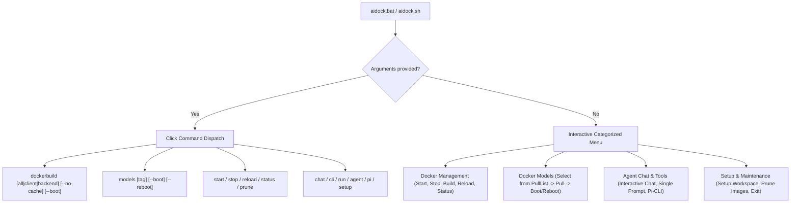

# AIDock CLI Tool Enhancement Plan

## 1. Executive Summary
This plan details the transformation of `aidock.bat` / `aidock.sh` and `cli/aidock.py` into a unified, interactive, and argument-driven CLI tool.
When invoked with arguments (e.g., `aidock start`, `aidock dockerbuild`, `aidock models`), it directly executes the specified subcommand. When invoked without arguments, it launches a rich, categorized Questionary interactive menu.

---

## 2. Architecture & Command Hierarchy



---

## 3. Detailed Component Specifications

### 3.1. Interactive Menu (`invoke_without_command=True`)
Configured via Click:
```python
@click.group(invoke_without_command=True)
@click.pass_context
def cli(ctx):
    if ctx.invoked_subcommand is None:
        interactive_menu(ctx)
```
The menu organizes actions into clean Questionary categories with icons and plain descriptions:
1. **Docker Management:**
   - `Start Stack` (`start`)
   - `Stop Stack` (`stop`)
   - `Build Containers` (`dockerbuild`)
   - `Reload Services` (`reload`)
   - `System Status` (`status`)
2. **Docker Models (Model Runner):**
   - `Select & Pull Model` (`models`) -> loads `DockerModel_PullList.txt`
3. **Agent Chat & Tools:**
   - `Interactive Chat` (`chat` / `cli`)
   - `Run Single Prompt` (`run`)
   - `Pi-CLI Coding Agent` (`agent` / `pi`)
4. **Setup & Maintenance:**
   - `Setup Workspace & Profile` (`setup`)
   - `Prune Docker Images` (`prune`)
   - `Exit`

---

### 3.2. New Command: `dockerbuild`
- **CLI Arguments:**
  `aidock dockerbuild [SERVICE] [--no-cache] [--boot]`
  - `SERVICE`: `all` (default), `client` (or `fe`), `backend` (or `be`), `db`.
  - `--no-cache`: pass `--no-cache` to Docker Compose.
  - `--boot`: immediately bring up the updated containers with `docker compose up -d`.
- **Interactive Flow (when run without arguments):**
  1. Service choice: `All Services`, `Frontend Client (client)`, `Backend Engine (backend)`, `Database (db)`.
  2. Questionary confirm: `Use clean build without cache (--no-cache)?`
  3. Questionary confirm: `Boot / start containers immediately after build?`
  4. Execution with live output streaming.

---

### 3.3. New Command: `models` (Docker Models from `DockerModel_PullList.txt`)
- **CLI Arguments:**
  `aidock models [MODEL_TAG] [--boot] [--reboot]`
- **Pull List Parsing:**
  - Reads `DockerModel_PullList.txt` in the root workspace.
  - Strips `docker pull` and `docker model pull` prefixes.
  - Checks local Docker image cache via `docker image inspect` or `docker model list` to indicate if the model is `[Already Pulled]` or `[Available to Pull]`.
- **Interactive Flow:**
  1. Select model from filtered list.
  2. Pull model using the proper Docker command (`docker pull <image>` or `docker model pull <image>`) with live output streaming.
  3. Update `.env` with:
     - `LLM_IMAGE=<selected_image>`
     - `LLM_MODEL_NAME=<clean_name>`
  4. Prompt for follow-up action:
     - **Boot:** Start Docker Compose stack (`docker compose up -d`).
     - **Reboot:** Rebuild and restart stack (`docker compose up -d --build`).
     - **Stay Current:** Save configuration without restarting containers now.

---

## 4. Verification Plan
1. Test argument execution: `python cli/aidock.py --help`
2. Test `dockerbuild` command with `--help` and interactive options.
3. Test `models` command parsing of `DockerModel_PullList.txt`.
4. Test interactive menu launch when no arguments are provided.
